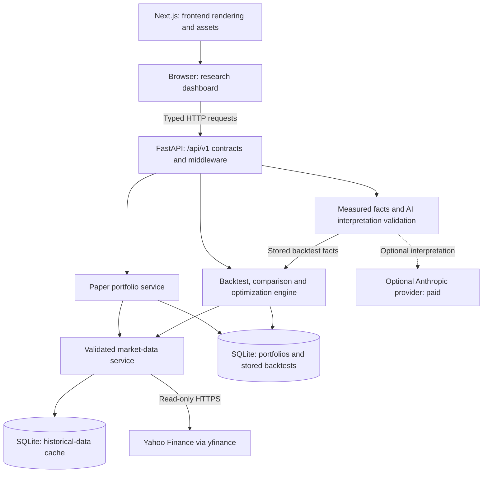

# Vektor

**A local-first, paper-only workspace for researching trading strategies with real historical market data.**

Vektor combines simulated USD portfolios, historical backtests, strategy comparison, and parameter optimization in a dark research dashboard. It keeps financial calculations on a Python backend and presents the results through a typed Next.js frontend. Optional AI explanations interpret measured backtest facts; they do not calculate balances or place orders.

**Educational simulation only.** No brokerage connection, live execution, or real-money trading exists. Historical prices are real; cash, positions, fills, and performance are simulated. Past results do not predict returns, and AI output is not investment advice.

[Quick start](#quick-start) · [Architecture](#architecture) · [API](#api-and-documentation) · [Deployment](#deployment) · [Engineering](#engineering-decisions) · [Portfolio summary](PORTFOLIO.md)

## Features

| Workflow | Implemented behavior |
|---|---|
| Historical market research | On-demand daily OHLCV from Yahoo Finance through `yfinance`, validated and cached in SQLite. Interactive close-price charts preserve missing dates. No live quotes or generated prices. |
| Paper portfolios | API-based portfolio management and idempotent buy/sell orders with virtual USD. The dashboard displays holdings, cash, realized/unrealized P&L, and transaction history. Portfolio creation and order entry are available through the API, not dedicated dashboard forms. |
| Portfolio analytics | Recorded equity snapshots, returns, annualized volatility, Sharpe ratio, and drawdown. Allocation, concentration, risk contributions, and correlations describe current holdings. Insufficient history and unavailable prices remain explicit. |
| Strategy backtesting | Buy & Hold, SMA crossover, and Wilder's RSI; configurable capital, fees, and slippage. Equity/drawdown charts, performance metrics, and sortable simulated trades. The API supports multiple symbols; the current backtest form accepts one ticker. |
| AI strategy insights | Optional on-demand summaries, behavior, strengths, weaknesses, risks, and limitations, citing locally measured facts. AI-off responses still include facts and report interpretation as unavailable. |
| Strategy comparison | Compare 2–5 distinct configurations on one ticker with shared settings. Interactive equity curves, side-by-side metrics, baseline differences in the API, and backend-reported metric leaders. |
| Parameter optimization | Bounded SMA/RSI grid search with up to 100 valid combinations. Training-only ranking, a chronological holdout, ranked parameter results, separate train/test charts, and overfitting warning flags. |

The frontend includes keyboard chart exploration, responsive tables, focus states, reduced-motion support, and clear loading/error/empty states. Core workflows require no AI account. Fetching market data requires internet access; the app shell and local storage do not require a hosted service.

## Tech stack

| Layer | Technologies |
|---|---|
| Frontend | Next.js 16 App Router, React 19, TypeScript, Tailwind CSS 4, Motion |
| Visualization | Custom responsive SVG charts, shared geometry utilities, native keyboard range controls; no third-party chart library |
| Backend | FastAPI, Pydantic/pydantic-settings, Uvicorn, Python `Decimal` |
| Data and storage | Yahoo Finance via `yfinance`, SQLite for portfolios, backtest results, and history cache |
| Optional AI | Anthropic SDK, configured exclusively on the backend |
| Tooling | `uv` and `uv.lock`; npm and `package-lock.json`; pytest, HTTPX, Node's test runner, ESLint, TypeScript |

## Architecture



The browser calls the backend directly; Next.js is not an order-routing proxy. Completed standalone backtests are stored; comparisons and optimizations are calculated on request and are not persisted. AI interpretations are also generated on request.

```text
backend/
  app/contracts.py       Versioned request/response models
  app/routers/           Market, portfolio, and backtest endpoints
  app/portfolio/         Decimal accounting, analytics, risk, SQLite storage
  app/backtest/          Signals, simulation, comparison, optimization, storage
  app/market_data/       Provider validation, caching, bounded fetching
  app/analysis/          Measured facts, provider integration, evidence checks
  tests/                 Isolated backend regression tests
frontend/
  src/app/               Next.js page, layout, theme
  src/components/        Dashboard, research forms, results, shared UI
  src/hooks/             Request lifecycle and cancellation
  src/lib/               Typed API client, chart geometry, exact money formatting
  tests/                 API, component, chart, accessibility, performance tests
```

## Quick start

Requirements: [uv](https://docs.astral.sh/uv/), Node.js **22.13 or later**, and npm. The backend declares Python 3.12+ and pins **3.13** in `.python-version`; `uv` can install that interpreter. Start from this repository's root after cloning or downloading it.

### 1. Run the backend

In one terminal:

```sh
cd backend
uv sync
# Optional: copy defaults into an untracked local configuration file.
cp .env.example .env
uv run uvicorn app.main:app --reload
```

Check [http://localhost:8000/api/v1/health](http://localhost:8000/api/v1/health). Interactive API documentation is available at [http://localhost:8000/docs](http://localhost:8000/docs) in development. Health checks configuration/liveness, not Yahoo or AI availability.

### 2. Run the frontend

In another terminal, starting from the repository root:

```sh
cd frontend
npm ci
# Optional for development: the default backend is http://localhost:8000.
cp .env.example .env.local
npm run dev
```

Open [http://localhost:3000](http://localhost:3000). The default backend CORS configuration permits that origin.

### 3. Explore real workflows

Load historical prices, run a backtest, compare configurations, or optimize an SMA/RSI grid from the dashboard. All simulation end dates must precede today in UTC. Parameter warm-up requirements can make short periods unavailable.

The portfolio dashboard starts empty. To create a paper portfolio, use the API documentation or this request in a third terminal:

```sh
curl -X POST http://localhost:8000/api/v1/portfolios \
  -H 'content-type: application/json' \
  -d '{"name":"Research portfolio","starting_cash":"10000.00"}'
```

Then select **Refresh portfolios** in the dashboard. This creates virtual cash, not a deposit. Use the portfolio API for simulated orders and explicit equity snapshots; Vektor does not backfill or schedule snapshots.
