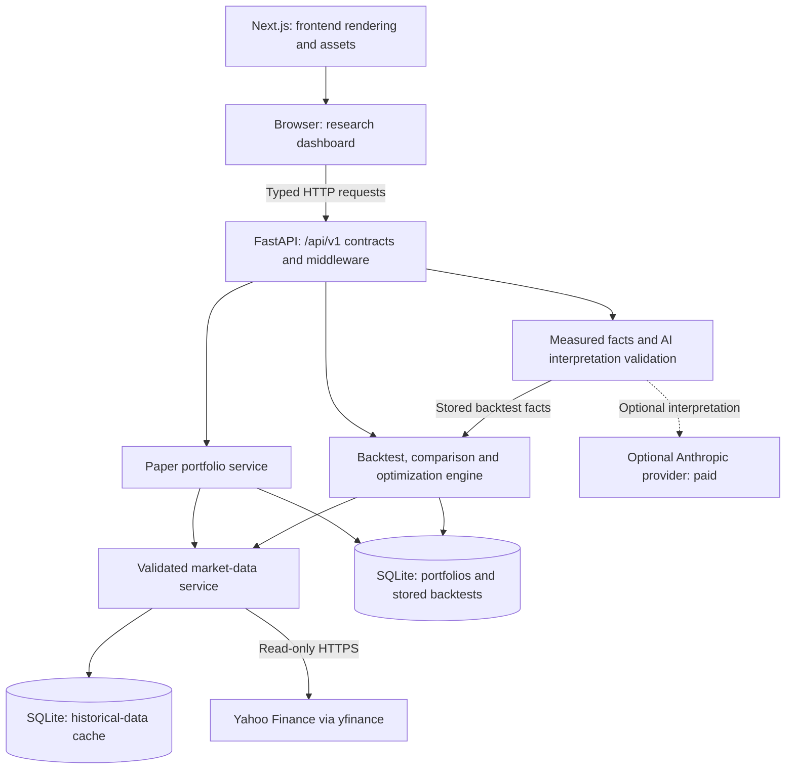

# Vektor

**A local-first, paper-only workspace for researching trading strategies with real historical market data.**

Vektor combines simulated USD portfolios, historical backtests, strategy comparison, and parameter optimization in a dark research dashboard. It keeps financial calculations on a Python backend and presents the results through a typed Next.js frontend. Optional AI explanations interpret measured backtest facts; they do not calculate balances or place orders.

**Educational simulation only.** No brokerage connection, live execution, or real-money trading exists. Historical prices are real; cash, positions, fills, and performance are simulated. Past results do not predict returns, and AI output is not investment advice.

[Quick start](#quick-start) · [Architecture](#architecture) · [API](#api-and-documentation) · [Deployment](#deployment) · [Engineering](#engineering-decisions) · [Portfolio summary](PORTFOLIO.md)

## Features

| Workflow | Implemented behavior |
|---|---|
| Historical market research | On-demand daily OHLCV from Yahoo Finance through `yfinance`, validated and cached in SQLite. Interactive close-price charts preserve missing dates. No live quotes or generated prices. |
| Paper portfolios | API-based portfolio management and idempotent buy/sell orders with virtual USD. The dashboard displays holdings, cash, realized/unrealized P&L, and transaction history. Portfolio creation and order entry are available through the API, not dedicated dashboard forms. |
| Portfolio analytics | Recorded equity snapshots, returns, annualized volatility, Sharpe ratio, and drawdown. Allocation, concentration, risk contributions, and correlations describe current holdings. Insufficient history and unavailable prices remain explicit. |
| Strategy backtesting | Buy & Hold, SMA crossover, and Wilder's RSI; configurable capital, fees, and slippage. Equity/drawdown charts, performance metrics, and sortable simulated trades. The API supports multiple symbols; the current backtest form accepts one ticker. |
| AI strategy insights | Optional on-demand summaries, behavior, strengths, weaknesses, risks, and limitations, citing locally measured facts. AI-off responses still include facts and report interpretation as unavailable. |
| Strategy comparison | Compare 2–5 distinct configurations on one ticker with shared settings. Interactive equity curves, side-by-side metrics, baseline differences in the API, and backend-reported metric leaders. |
| Parameter optimization | Bounded SMA/RSI grid search with up to 100 valid combinations. Training-only ranking, a chronological holdout, ranked parameter results, separate train/test charts, and overfitting warning flags. |

The frontend includes keyboard chart exploration, responsive tables, focus states, reduced-motion support, and clear loading/error/empty states. Core workflows require no AI account. Fetching market data requires internet access; the app shell and local storage do not require a hosted service.

## Tech stack

| Layer | Technologies |
|---|---|
| Frontend | Next.js 16 App Router, React 19, TypeScript, Tailwind CSS 4, Motion |
| Visualization | Custom responsive SVG charts, shared geometry utilities, native keyboard range controls; no third-party chart library |
| Backend | FastAPI, Pydantic/pydantic-settings, Uvicorn, Python `Decimal` |
| Data and storage | Yahoo Finance via `yfinance`, SQLite for portfolios, backtest results, and history cache |
| Optional AI | Anthropic SDK, configured exclusively on the backend |
| Tooling | `uv` and `uv.lock`; npm and `package-lock.json`; pytest, HTTPX, Node's test runner, ESLint, TypeScript |

## Architecture



The browser calls the backend directly; Next.js is not an order-routing proxy. Completed standalone backtests are stored; comparisons and optimizations are calculated on request and are not persisted. AI interpretations are also generated on request.

```text
backend/
  app/contracts.py       Versioned request/response models
  app/routers/           Market, portfolio, and backtest endpoints
  app/portfolio/         Decimal accounting, analytics, risk, SQLite storage
  app/backtest/          Signals, simulation, comparison, optimization, storage
  app/market_data/       Provider validation, caching, bounded fetching
  app/analysis/          Measured facts, provider integration, evidence checks
  tests/                 Isolated backend regression tests
frontend/
  src/app/               Next.js page, layout, theme
  src/components/        Dashboard, research forms, results, shared UI
  src/hooks/             Request lifecycle and cancellation
  src/lib/               Typed API client, chart geometry, exact money formatting
  tests/                 API, component, chart, accessibility, performance tests
```

## Quick start

Requirements: [uv](https://docs.astral.sh/uv/), Node.js **22.13 or later**, and npm. The backend declares Python 3.12+ and pins **3.13** in `.python-version`; `uv` can install that interpreter. Start from this repository's root after cloning or downloading it.

### 1. Run the backend

In one terminal:

```sh
cd backend
uv sync
# Optional: copy defaults into an untracked local configuration file.
cp .env.example .env
uv run uvicorn app.main:app --reload
```

Check [http://localhost:8000/api/v1/health](http://localhost:8000/api/v1/health). Interactive API documentation is available at [http://localhost:8000/docs](http://localhost:8000/docs) in development. Health checks configuration/liveness, not Yahoo or AI availability.

### 2. Run the frontend

In another terminal, starting from the repository root:

```sh
cd frontend
npm ci
# Optional for development: the default backend is http://localhost:8000.
cp .env.example .env.local
npm run dev
```

Open [http://localhost:3000](http://localhost:3000). The default backend CORS configuration permits that origin.

### 3. Explore real workflows

Load historical prices, run a backtest, compare configurations, or optimize an SMA/RSI grid from the dashboard. All simulation end dates must precede today in UTC. Parameter warm-up requirements can make short periods unavailable.

The portfolio dashboard starts empty. To create a paper portfolio, use the API documentation or this request in a third terminal:

```sh
curl -X POST http://localhost:8000/api/v1/portfolios \
  -H 'content-type: application/json' \
  -d '{"name":"Research portfolio","starting_cash":"10000.00"}'
```

Then select **Refresh portfolios** in the dashboard. This creates virtual cash, not a deposit. Use the portfolio API for simulated orders and explicit equity snapshots; Vektor does not backfill or schedule snapshots.

## Configuration

| Variable | Where | Purpose |
|---|---|---|
| `NEXT_PUBLIC_API_ORIGIN` | Frontend `.env.local` or hosting build environment | Backend origin only, without `/api/v1`, credentials, query, or fragment. Development defaults to `http://localhost:8000`; production requests require an explicit HTTPS non-loopback origin. Public and embedded into the browser bundle at build time. |
| `VEKTOR_TRADING_MODE` | Backend environment or `.env` | Literal `paper` only; other values fail validation. |
| `VEKTOR_ENVIRONMENT` | Backend | Development, test, or production behavior. |
| `VEKTOR_CORS_ORIGINS` | Backend | JSON list of exact permitted frontend origins. Required explicitly in production. CORS is not authentication. |
| `VEKTOR_PORTFOLIO_DB_PATH`, `VEKTOR_BACKTEST_DB_PATH` | Backend | Persistent SQLite databases; production requires explicit paths. |
| `VEKTOR_MARKET_DATA_CACHE_PATH` | Backend | Disposable historical-data cache. |
| `VEKTOR_AI_PROVIDER` | Backend | `none` by default; `anthropic` enables optional hosted analysis. |
| `VEKTOR_AI_API_KEY` or `ANTHROPIC_API_KEY` | Backend environment only | Optional provider credential. Never add it to frontend variables or committed files. |

See [backend defaults](backend/.env.example), [production settings](backend/deploy/production.env.example), and [frontend defaults](frontend/.env.example). Restart development or rebuild the frontend after changing its public backend origin. Never commit `.env` files or real credentials.

**Optional AI costs:** enabling Anthropic makes paid outbound requests billed to the configured account, including repeated requests for analysis. It is outside the free local default. Leave `VEKTOR_AI_PROVIDER=none` to avoid provider costs; portfolio, backtest, comparison, and optimization features remain available. The AI interprets facts and can be wrong even when its cited fact IDs are valid.

## API and documentation

All application endpoints use `/api/v1`. The canonical models are in [contracts.py](backend/app/contracts.py); errors use `{"detail": "..."}`.

| Endpoint | Purpose |
|---|---|
| `GET /api/v1/health` | Paper-only service liveness/configuration |
| `GET /api/v1/market/history` | Daily historical OHLCV |
| `POST /api/v1/portfolios`, `GET /api/v1/portfolios` | Create/list simulated portfolios |
| `/api/v1/portfolios/{id}` | Read, rename, or delete a portfolio |
| `POST /api/v1/portfolios/{id}/orders` | Submit an idempotent simulated market order |
| `GET /api/v1/portfolios/{id}/holdings`, `GET /api/v1/portfolios/{id}/transactions` | Valuation and executed paper trades |
| `POST /api/v1/portfolios/{id}/snapshots` | Record equity at completed closes |
| `GET /api/v1/portfolios/{id}/equity-history`, `/analytics`, `/allocation`, `/risk` | Recorded performance and current-position analysis; the latter three paths share the portfolio prefix |
| `POST /api/v1/backtests`, `GET /api/v1/backtests`, `GET /api/v1/backtests/{id}` | Run/store, list, and retrieve standalone backtests |
| `POST /api/v1/backtests/{id}/analysis` | Measured facts and optional AI interpretation |
| `POST /api/v1/backtests/comparisons` | Shared-data strategy comparison |
| `POST /api/v1/backtests/optimizations` | Bounded grid search and train/test evaluation |

- [Backend setup, formulas, request examples, security, and limitations](backend/README.md)
- [Frontend setup and design notes](frontend/README.md) — includes earlier phase notes; the feature table above reflects the current implementation.
- [Backend deployment, backups, and rollback](backend/DEPLOYMENT.md)
- [Frontend deployment guide](frontend/DEPLOYMENT.md)
- [Reproducible backend benchmarks](backend/benchmarks/README.md)
- [Repository ownership and contribution constraints](AGENTS.md)

## Testing

From `backend/`:

```sh
uv run pytest
```

Backend tests mock providers and use temporary storage; they do not require market-data or AI network calls. Regression tests cover accounting, API validation, security/resource limits, deterministic financial results, comparisons, and optimization behavior.

From `frontend/`:

```sh
npm run typecheck
npm run lint
# Use a real deployed backend origin before publishing. This reserved example is build verification only.
NEXT_PUBLIC_API_ORIGIN=https://backend.example.com npm run build
npm test
```

Build before `npm test`: rendered-page tests read the production HTML. Frontend tests use mocked requests and exercise exact decimal presentation, chart geometry, component states, keyboard controls, and request cancellation. Synthetic test fixtures are not market data displayed by the running application. These commands describe the verification workflow, not a claim that checks were run for this documentation update.

## Deployment

The documented setup is **Vercel for Next.js** and **Fly.io for the FastAPI backend**. Vercel Hobby is free only for eligible uses; Fly.io compute and persistent storage incur charges. Check current provider terms and pricing.

**Live:** https://vektor-paper.vercel.app (frontend) and https://vektor-api.fly.dev ([health](https://vektor-api.fly.dev/api/v1/health)), deployed and verified on 2026-11-09. Details, costs, and the live check results are in [backend/DEPLOYMENT.md](backend/DEPLOYMENT.md) and [backend/LAUNCH_READINESS.md](backend/LAUNCH_READINESS.md).

1. Configure the frontend host with root directory `frontend`, the Next.js framework, `npm ci`, and `npm run build`.
2. Set `NEXT_PUBLIC_API_ORIGIN` to the actual HTTPS backend origin **before building**. `next.config.ts` fails a production build when it is missing, not HTTPS, or a loopback address.
3. Run the backend as **one process on one machine**, with a persistent volume for both portfolio and backtest databases. The [Fly manifest](backend/fly.toml) is configured for the live `vektor-api` app; change `app` and `VEKTOR_CORS_ORIGINS` for a deployment of your own.
4. Keep AI credentials on the backend, configure exact HTTPS CORS origins, and verify health plus real data workflows before sharing access.
5. Follow the backend deployment guide for backups and rollback. A frontend rollback does not restore backend data.

Render's free backend option is documented for disposable demos only: without persistent storage, portfolio/backtest data can be lost on restart or redeployment. Fly idle stops introduce cold starts, and restarts interrupt in-flight requests. Yahoo may rate-limit or block hosting-provider IPs. Frontend errors report outages rather than inventing data.

**Access limitation:** there are no user accounts or per-user isolation. Production runs in public mode: anyone can read paper portfolios and run research, but creating, changing or trading in portfolios needs the deployment owner's key. CORS does not secure non-browser clients. Hosted AI can incur costs and is off on the live deployment. API docs are disabled by default in production.

## Engineering decisions

- **Exact accounting over floating-point convenience.** Python `Decimal`, explicit rounding, decimal-text storage, and JSON strings protect cash and P&L. Frontend money formatting uses integer cents; numeric chart coordinates do not replace exact displayed values.
- **Atomic orders over optimistic balance updates.** SQLite `BEGIN IMMEDIATE` and per-portfolio idempotency keys put duplicate detection, balance checks, position changes, and transaction writes under one write lock. Failed orders roll back.
- **Explicit unknowns over plausible-looking values.** Missing metrics stay `null`. Unpriced holdings make aggregate valuation unavailable. Invalid historical rows are rejected; a newest unfinished session may be omitted until finalized, never filled.
- **Controlled simulations over execution realism.** Backtest close signals fill at the next simulated open, with adjusted prices and configured costs. Portfolio market orders instead use the latest completed daily close. These are distinct models, not real execution.
- **Holdout evaluation over ranking on future data.** Optimization ranks training results only and resets cash/positions for each segment. A single split is still vulnerable to selection bias; warning flags are not proof of robustness.
- **Targeted caching over hidden data changes.** The backend caches validated history, bounds concurrent fetches, reuses indicators, and compresses large responses. Frontend comparison charts memoize geometry/paths, preserve observations, and skip repeated cursor-driven computations. Regression tests pin financial outputs and request lifecycle behavior; see the linked benchmark and test sources for evidence.
- **Local simplicity over multi-tenant scale.** SQLite and in-memory request limits keep setup small but require a single backend process and persistent storage. Strict contracts, bounded workloads, CORS, security headers, sanitized errors, and JSON request logs add defenses without supplying authentication.

### Modeling limitations

Daily data does not model intraday paths, liquidity, partial fills, or realistic market impact. Backtests are long-only, use whole shares and adjusted historical prices, and support USD instruments. Paper portfolio orders allow fractional shares, but do not charge fees or apply corporate-action quantity adjustments or dividend credits; holdings carried through splits can therefore be valued incorrectly.

Snapshot analytics use only recorded observations, with no historical reconstruction. Current-holdings risk assumes today's quantities across its historical window rather than replaying past trades. Annualized statistics from short or irregular observation histories can be misleading. Yahoo can revise adjusted history, so a later provider response can change a later simulation even though computation on identical inputs is deterministic.

## Screenshots

No committed screenshots were found in this checkout. These are capture placeholders, not screenshots or fabricated demonstrations:

| View | Screenshot status |
|---|---|
| Portfolio dashboard and analytics | Placeholder — capture an actual running dashboard |
| Backtest results and AI Insights | Placeholder — show returned data and the provider's actual availability state |
| Strategy comparison | Placeholder — capture shared-date curves and metric leaders |
| Optimization | Placeholder — capture ranked parameters and labeled train/test results |

## Project use and attribution

See [PORTFOLIO.md](PORTFOLIO.md) for a concise technical summary. No license file is present in this checkout; a public repository alone does not grant an open-source license. Maintainers should choose an explicit license before representing reuse rights.
